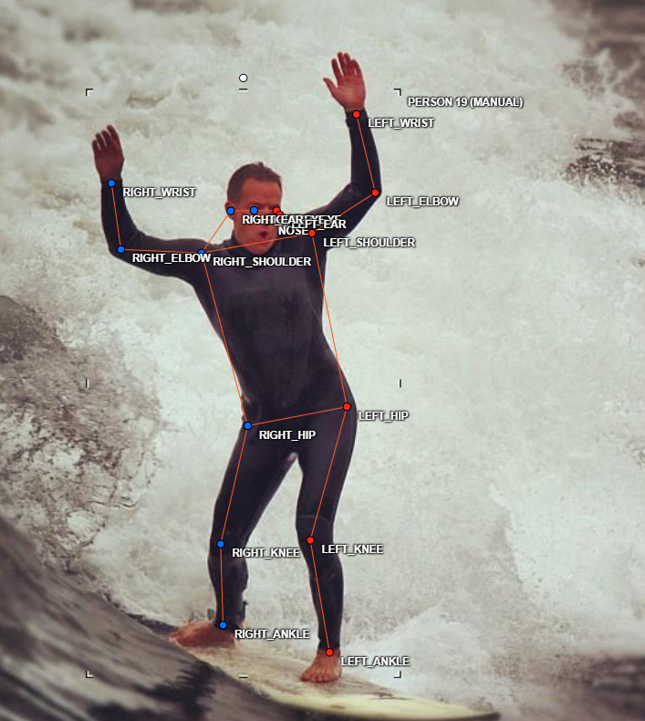
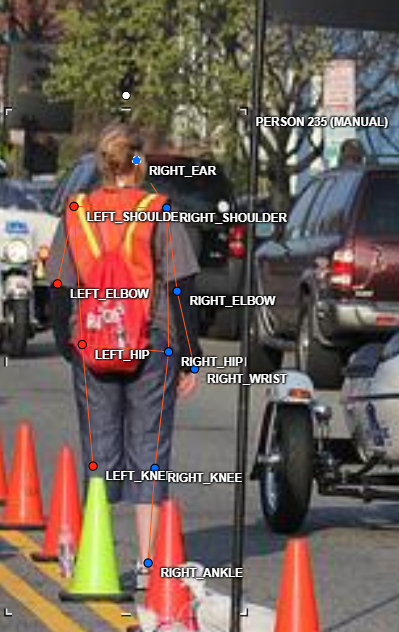
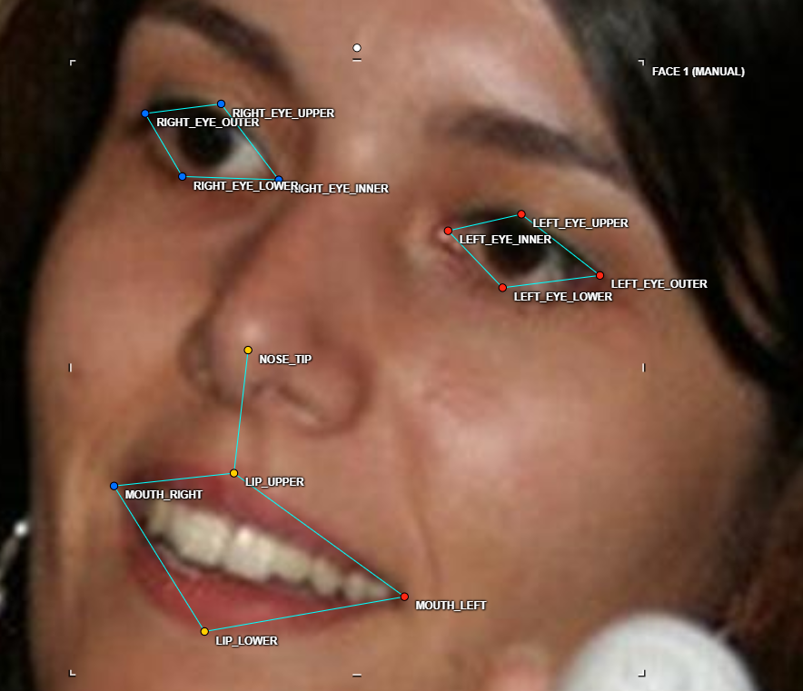
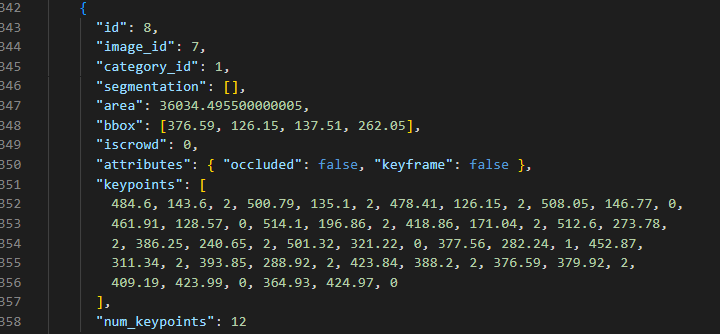

# Báo cáo cá nhân - Đặng Trung Hiếu - 2A202603248


Dữ liệu: 12 ảnh người COCO val2017 (Lin et al., 2014) và 8 ảnh chân dung Wikimedia Commons, chỉ dùng trong lớp.

## 0. Thông tin học viên

- Họ tên: Đặng Trung Hiếu
- MSSV: 2A202603248
- Email: ladykiller12.2005@gmail.com
- Link repository: 
- Phiên bản CVAT (Help → About):
- Máy: hệ điều hành Win 11 · RAM 16 GB · chạy CVAT chế độ đầy đủ 
- Bộ ảnh (`src/exports/assignment.json` do `lab.py setup` tạo): có 
- Giờ bắt đầu: 16h30 12/11/2026
- Giờ kết thúc: 12h 13/11/2026

## 1. Kiểm tra label (CP0)

| Label | Kiểu | Số điểm | Tên điểm đúng bảng của lab? | Đúng thứ tự? | Số cạnh |
|---|---|---:|---|---|---:|
| `person` | skeleton  17 điểm| | | | |
| `face` | skeleton | 13 điểm | | | |

Mẫu `person` dựng theo người quay mặt về camera (các điểm `left_*` nằm bên phải khung mẫu)? Có / Không

Cách đổi cờ `occluded` / `outside` cho **một điểm** trên phiên bản CVAT này (một câu):

...

## 2. Số lượng đã gán và thời gian (CP1, CP2)

| Nhóm ảnh | Số ảnh | Số skeleton đã gán | Số người dưới 60 px (không gán) | Số poster / gương / màn hình bỏ qua | Thời gian (phút) |
|---|---:|---:|---:|---:|---:|
| `easy` | 5 |5 | 0 |0 | 30p |
| `occluded` | 3 | 3 |0 |0 |30p |
| `back` | 2 |2 | 0| 0|30p |
| `small` | 1 |1 |0 |0 | 30p|
| `crowd` | 1 | 1| 3| 0| 15p |
| `faces` | 8 |8 | — | 0 | 15p |

- Số ảnh người đã xong ở mốc phút 105: 10 / 10
- Thời gian thực tế (phút): CP1 2h · CP2 1h · CP3 1h                                                                        
- Ảnh tốn thời gian nhất là ảnh nào, vì sao?
ảnh tốn thời gian nhất là ảnh 000000332273.jpg, vì có nhiều người và mỗi người 1 tư thế, tay chân người này dính sang người kia 

## 3. Bảng ca khó (CP1, CP2)

Mỗi điểm bạn phân vân một dòng, nhất là phân vân giữa `v = 1` và `v = 0`, hoặc không chắc hướng người.

| Ảnh | Người / mặt | Điểm | Cờ đã chọn | Phân vân giữa | Lý do chọn |
|---|---|---|---:|---|---|
|000000461002.jpg | người  | right_ear | v=1 | v=1 hay v=2 |cái tai phải của trẻ con nữ đang bị hơi mờ nhưng gióng được từ mắt qua lên em sẽ để v=2 |


## 4. Bảng tự review (CP3)

Đi từ ảnh cuối về ảnh đầu. 5 ảnh người (ít nhất 2 ảnh `back` hoặc `crowd`) và 3 ảnh mặt. Ít nhất 8 dòng, kể cả dòng `ok`. Ghi lỗi trước, sửa sau.

Mã lỗi dùng đúng một trong: `lr_swap`, `vis_flag`, `position`, `missing`, `extra`, `ok`.

| Ảnh | Người / mặt | Điểm | Mã lỗi | Ghi chú | Đã sửa? |
|---|---|---|---|---|---|
|000000332273.jpg | 3 | ok |ok |từ phần hông trở xuống đã gán đúng điểm cảnh báo của script đang nhầm | không cần sửa |
|000000106051.jpg | 2 | right_knee | vis_flag | từ hông phải xuống đầu gối phải phân vân giữa v= 1 và v= 2 ban đầu chọn v=2, sau đổi thành v=1 vì đang bị cỏ che mất ít phần đầu gối  | đã sửa |
|000000461002.jpg	| 2 | right_ear | vis_flag | phân vân giữa v=1 và v=2 ban đầu là chọn v=1 vì tai khá mờ sau chuyển thành v=2 thì có thể thấy tai và gióng từ mắt sang lên chắc chắn là tai | đã sửa|
|000000359340.jpg | 1 | cả người (17 điểm) |lr_swap | dùng skeleton bị ngược | đã sửa |
|000000375535.jpg | 1 |cả người (17 điểm) |lr_swap | dùng skeleton bị ngược| đã sửa|
|face_560526.jpg | 1 | 13 điểm |ok |ok | không cần sửa |
|face_146049.jpg | 1 | 4 điểm mắt |vis_flag | mới đầu để v=2 vì em nghĩ để v=2 được sau khi được BTC giải đáp thì đã sửa sang v=1 vì mình vấn có thể ước lượng vùng mắt |đã sửa |
|face_143959.jpg | 1 |13 điểm |ok |ok | không cần sửa |


Tổng hợp số lỗi theo mã:

| `lr_swap` | `vis_flag` | `position` | `missing` | `extra` | `ok` |
|---:|---:|---:|---:|---:|---:|
|2 |3 |0 | 0| 0| 3|

Điểm còn phân vân giữa `v = 1` và `v = 0` (ghi cả hai lựa chọn và lý do chọn):

sau khi được các anh lab coach giải đáp thì đã không còn phân vân nữa

## 5. Kiểm file xuất và kết quả tự kiểm (CP4)

Tự kiểm tay trong file JSON:

| File | Người / mặt kiểm (ảnh, thứ tự) | Số phần tử `keypoints` | Điểm `outside` ra `v = 0`, `occluded` ra `v = 1`? | `num_keypoints` khớp? |
|---|---|---:|---|---|
| `DangTrungHieu_persons.zip` | `000000106051.jpg`, người #2 | 51 | Có: `right_knee` (occluded) ra `v = 1`; 7 điểm outside ra `v = 0` | Có (10 = số điểm `v > 0`) |
| `DangTrungHieu_persons.zip` | `000000184224.jpg`, người #1 | 51 | Có: `left_ear`, `right_ear`, `right_knee` ra `v = 1`; `right_ankle` ra `v = 0` | Có (16) |
| `DangTrungHieu_faces.zip` | `face_146049.jpg`, mặt #1 | 39 | Có: 8 điểm mắt (occluded) ra `v = 1` | Có (13) |

Sau khi xuất, CVAT ghi `occluded` thành `v = 1` và `outside` thành `v = 0`. Tọa độ của điểm `outside` trong file là `0, 0` hay tọa độ cũ? Tọa độ cũ (cả 78 điểm `v = 0` đều giữ tọa độ cũ, không có điểm nào là 0, 0).

Hai job đã chuyển sang completed trên CVAT? đã chuyển

Dán phần **TÓM TẮT** in ra từ `src/check_submission.py`:

```text
- File person: DangTrungHieu_persons.zip
  Số ảnh: 12 · số skeleton `person`: 16 · mỗi annotation 51 số
  Skeleton theo ảnh: 000000090646=1, 000000103970=1, 000000106051=2, 000000183176=1, 000000184224=1, 000000225138=1, 000000314154=1, 000000332273=3, 000000349521=1, 000000359340=1, 000000375535=1, 000000461002=2
  Cờ v: v=2 193 (71%) · v=1 9 (3%) · v=0 70 (26%)
  num_keypoints trung bình: 12.6
- File face: DangTrungHieu_faces.zip
  Số ảnh: 8 · số skeleton `face`: 8 · mỗi annotation 39 số
  Skeleton theo ảnh: face_105668=1, face_10579=1, face_125051=1, face_143959=1, face_146049=1, face_185015=1, face_261458=1, face_560526=1
  Cờ v: v=2 88 (85%) · v=1 8 (8%) · v=0 8 (8%)
  num_keypoints trung bình: 12.0
- Ghi chú: 78 điểm v = 0 vẫn mang tọa độ cũ (CVAT 2.x xuất như vậy; chuẩn COCO ghi 0, 0). Không phải lỗi: điểm v = 0 bị bỏ qua khi huấn luyện và khi chấm.
- Số [LỖI]: 0 · số [CẢNH BÁO]: 1
Kết quả: ĐẠT (đọc lại từng cảnh báo ở trên)
```

Các `[CẢNH BÁO]` còn giữ nguyên và lý do:
000000332273.jpg #1: cặp ankle nằm ngược phía so với các cặp còn lại. Có thể đổi trái/phải một cặp (`lr_swap`), hoặc tay / chân bắt chéo thật: kiểm lại.
giữ nguyên bởi vì đã kiểm tra và gán nhãn đúng 
...

## 6. Ảnh chụp màn hình

1. Label `person` trong label constructor (đủ 17 điểm có tên):

   

2. Một người quay lưng đã gán, cờ đã đặt:

   

3. Một khuôn mặt đã gán 13 điểm, phóng to vùng mắt:

   

4. Một đoạn JSON xuất của một người:

   

Nguồn ảnh: COCO val2017 / Wikimedia Commons.

## 7. Tự đánh giá

1. Lỗi bạn mắc nhiều nhất hôm nay, và cách bạn sẽ tránh ở dự án thật:

   ...

2. Một quy tắc bạn đề xuất thêm vào guideline (kèm ảnh ví dụ nếu có):

   ...

3. Nhãn của bạn đi vào model ở đâu? Chọn một lỗi bạn đã sửa và nói nó sẽ làm model học sai thế nào (heatmap, trọng số trong loss, hay bước lật ảnh):

   ...

## 8. Khó khăn và lỗi kỹ thuật

...

## Bonus (nếu làm)

### B1 — 3 ảnh người khó thêm

| Ảnh | Số skeleton | Số người dưới 60 px | Ca khó nhất |
|---|---:|---:|---|
| | | | |
| | | | |
| | | | |

Kết quả `src/check_submission.py` cho `HoVaTen_bonus_persons.zip`:

```text
(dán ở đây)
```

### B2 — 5 ảnh khuôn mặt đen trắng / hồng ngoại

Ảnh không màu khó hơn ở điểm nào? Kính râm trên ảnh hồng ngoại có còn là `v = 1` không?

...

### B3 — Model so với nhãn của tôi (không tính điểm)

- Demo đã dùng:
- Ảnh đã thử:

1. Model có trả điểm cho khớp bị che, hay khớp ngoài ảnh không? Confidence ở các điểm đó thế nào?

   ...

2. Với người quay lưng, model có đổi trái/phải không?

   ...

3. Bộ điểm của model có giống 17 điểm COCO không?

   ...

## 9. Tài liệu tham khảo và công cụ AI đã dùng

...
